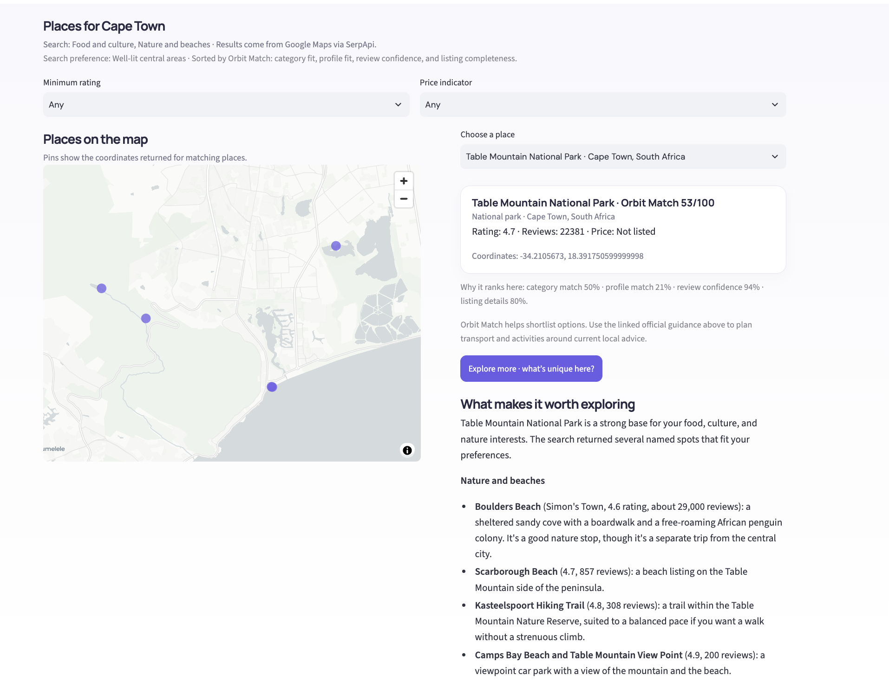
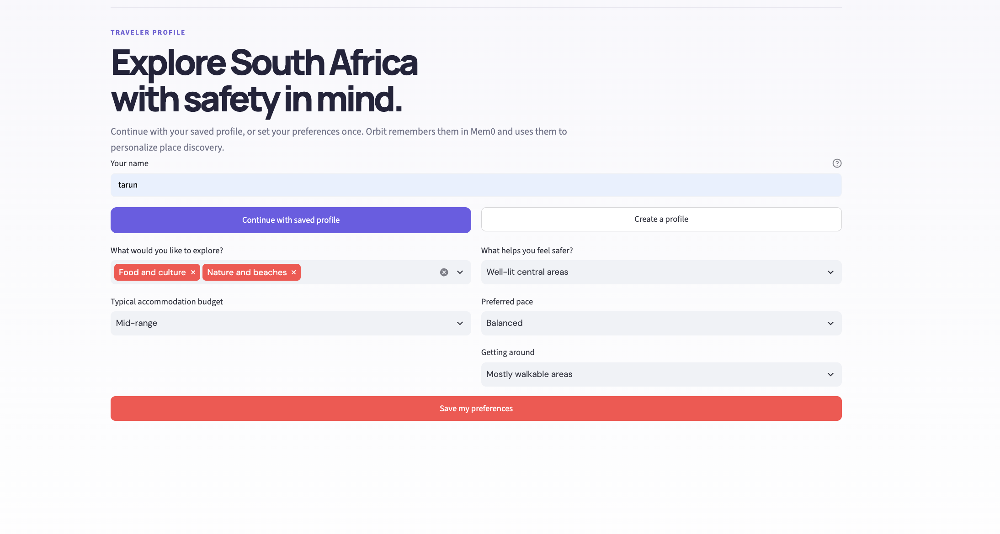
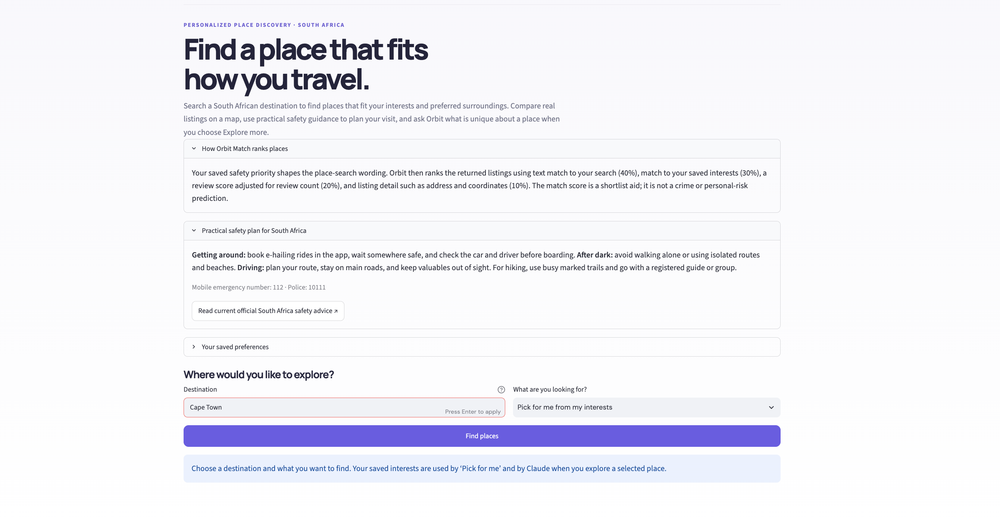

# Orbit

## Why I built Orbit

I was recently in Cape Town and wanted to see more of the city. But whenever I considered a place, the same question came up: how would I get there, and would I feel comfortable exploring that area?

It’s a concern many people in South Africa know well. Stats SA estimates there were **515,000 street robbery incidents in 2025/26**. Its survey also found that **37.9% of people felt safe walking alone in their neighbourhood after dark**. These figures describe the national picture; they don't tell a traveler the risk at a particular place. ([Stats SA, 2025/26](https://www.statssa.gov.za/?p=19867))


That experience inspired me to build Orbit. It helps travelers find places that match their interests, see them on a map, and bring practical safety guidance into the planning process. My goal is to make choosing where to explore in South Africa feel easier and more informed.

**Safety-aware place discovery for travel in South Africa.** Orbit uses a traveler's saved preferences to find and map places, then pairs the shortlist with practical safety guidance and links to official sources.

Save a traveler profile once and retrieve it on return using the same name. Search a destination by interest, filter Google Maps results by rating or price, compare place coordinates on a map, and review relevant official safety guidance. Select a place and click **Explore more** to ask Claude for distinctive nearby ideas tailored to the saved profile.

> Watch launch Orbit

https://github.com/user-attachments/assets/9cb2112d-1973-497a-8c8c-e29e35419e8c

## Orbit Match

Orbit uses a transparent, two-stage discovery algorithm. First, the traveler's saved safety priority shapes the Google Maps query with a search hint, such as central visitor areas or places near public transport. This guides discovery; it does not establish that an area is safe. Returned listings are then ranked with a 0–100 match score:

- 40% match between the requested activity and listing text
- 30% match between saved traveler interests and listing text
- 20% review confidence, using a 4/5 prior with a 20-review weight so a small number of ratings has less influence
- 10% listing completeness, based on whether an address, category, latitude, longitude, and source link are available

The score explains relevance and information quality; it is not a crime or personal-risk prediction. Orbit surfaces destination-related official safety pages when available, with national South Africa travel advice as a fallback. Use the linked guidance to plan transport, timing, and activities.



## Setup

Add provider credentials to `.streamlit/secrets.toml`:

```toml
SERPAPI_API_KEY = "your-serpapi-key"
ANTHROPIC_API_KEY = "your-anthropic-key"
MEM0_API_KEY = "your-mem0-platform-key"
```

Install [uv](https://docs.astral.sh/uv/getting-started/installation/), install dependencies, and start Orbit:

```bash
uv sync
uv run streamlit run app.py
```

`app.py` owns the Streamlit flow, filters, and map. `recommendations.py` implements Orbit Match. `tools.py` searches Google Maps and official safety pages through SerpApi. `agent.py` stores and retrieves traveler preferences with Mem0. Only after the traveler selects a place and clicks **Explore more**, Claude (`claude-haiku-5-5`) uses Anthropic's tool-use loop to choose a nearby search based on the place and saved preferences, run it through SerpApi, and explain the returned results.

### Traveler profile

Set interests, budget, pace, transport, and the safety priorities Orbit should use when shaping place searches. Mem0 keeps the profile available when the traveler returns.



### Pick for me

Choose **Pick for me from my interests** to find places using the traveler's saved interests, or select a specific type of place to guide the search.



## License

Orbit is licensed under the [MIT License](LICENSE).
